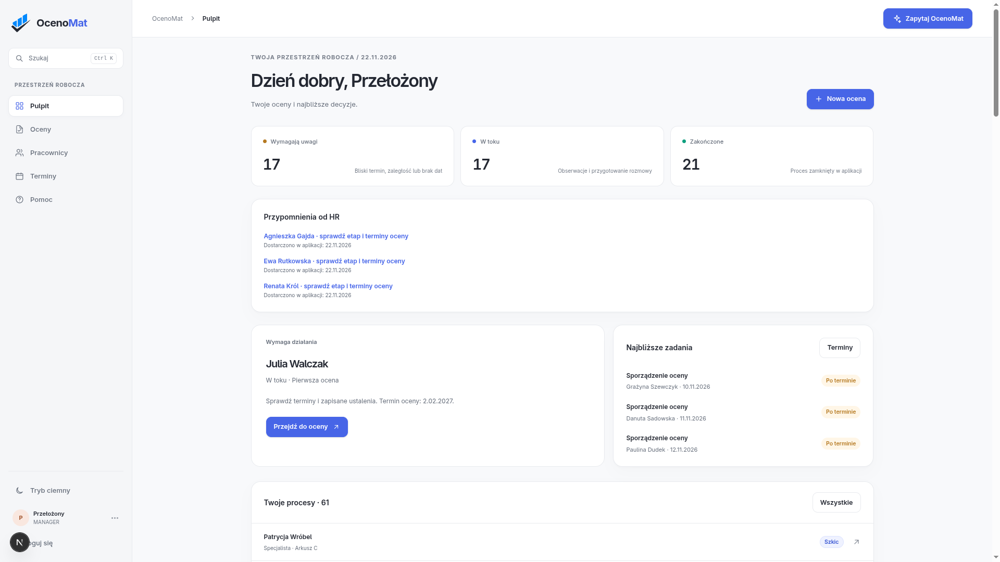
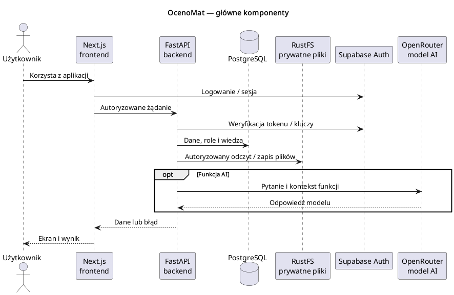

# OcenoMat — Kompas Kompetencji

## [Otwórz aplikację demo → https://2.29.111.76](https://2.29.111.76)

OcenoMat to prototyp aplikacji wspierającej ocenianie pracowników służby cywilnej.
Prowadzi przełożonego przez ocenę okresową lub pierwszą ocenę, pomaga przygotować
rozmowę i uporządkować dokumenty, a HR pozwala monitorować przebieg procesów.
Asystent AI wspiera pracę ze źródłami i danymi oceny; decyzje pozostają po stronie
uprawnionego przełożonego, a wynik formalny oblicza backend.

**[Galeria aplikacji](docs/galeria/README.md)** · **[Poradnik dla jury](docs/poradnik-jury.md)** · **[Architektura](docs/architecture/README.md)** · **[Cała dokumentacja](docs/README.md)**

## Co można zrobić w aplikacji?

- **Przeprowadzić ocenę okresową B/C** — od wyboru pracownika i kryteriów, przez
  obserwacje i rozmowę, po decyzje, wynik i wygenerowanie arkusza PDF.
- **Prowadzić pierwszą ocenę** — odrębny proces obejmujący m.in. ustalenia,
  sprawozdanie, egzamin, rozmowę i ocenę elementów.
- **Wykorzystać AI** — przeanalizować opis stanowiska pracy (OSP) z cytatami,
  zapytać o przepisy i procedury lub przygotować rozmowę na podstawie zapisanej oceny.
  Propozycje AI nie zastępują wyboru ani decyzji przełożonego.
- **Monitorować procesy jako HR** — przeglądać etapy i terminy oraz zapisywać
  przypomnienia, bez dostępu wynikającego z samej roli HR do prywatnej treści ocen.
- **Przeglądać profile jako administrator** — dostęp do ocen i widoku HR wynika
  z odpowiednich uprawnień, a nie z samej roli administratora.

## Zobacz i przetestuj

| Materiał | Co zawiera |
| --- | --- |
| [Galeria aplikacji](docs/galeria/README.md) | 48 opisanych zrzutów 1920 × 1080 z rzeczywistej sesji: ocena okresowa, pierwsza ocena, AI, HR i administrator. |
| [Poradnik dla jury](docs/poradnik-jury.md) | Scenariusze dla trzech ról, instrukcje krok po kroku i wskazówki do oceny projektu. |
| [Przewodnik demonstracji](docs/demo-guide.md) | Konta, fikcyjni pracownicy i przygotowane przypadki do prezentacji. |

Galeria pokazuje pełną ścieżkę jednej oceny okresowej aż do PDF. Przykłady pierwszej
oceny pochodzą z kilku wcześniej przygotowanych procesów. Dane w demo są fikcyjne.
Dane dostępu do środowiska demonstracyjnego przekazuje operator; lokalne
logowanie jest dostępne pod adresem `http://localhost:3000/login` po konfiguracji.

## Architektura i dokumentacja

Aplikacja łączy frontend **Next.js** z modularnym backendem **FastAPI**.
**PostgreSQL** przechowuje dane biznesowe, **RustFS** — prywatne pliki,
**Supabase Auth** uwierzytelnia użytkowników, a **OpenRouter** udostępnia model AI
przez adapter backendu. Uprawnienia biznesowe i wynik oceny kontroluje backend.

- [Dokumentacja architektury](docs/architecture/README.md) — system i kontenery,
  proces oceny, asystent i RAG, analiza OSP, dane i bezpieczeństwo oraz diagramy.
- [Indeks dokumentacji](docs/README.md) — także plan i postęp backendu, ewaluacja
  asystenta oraz przeglądy źródeł wiedzy.
- [Stan prac i ograniczenia](docs/backend-progress.md) — aktualny zakres,
  wykonane kontrole i blokery; opis planu nie oznacza ukończonej funkcjonalności.

## Uruchomienie lokalne

Środowisko developerskie wymaga Docker Engine i Compose v2.20+, konfiguracji
zmiennych z `.env.example` oraz projektu Supabase Auth. Funkcje AI wymagają
dodatkowo skonfigurowanej usługi zewnętrznej. Szczegółowe kroki, inicjalizację
usług i zasady zachowania danych opisuje **[instrukcja środowiska lokalnego](infra/README.md)**;
konfigurację API i polecenia dla backendu znajdziesz w [backend/README.md](backend/README.md).

> [!NOTE]
> To prototyp, nie gotowe wdrożenie produkcyjne. Korzystaj z fikcyjnych danych.
> Kontekst oceny i analiza OSP trafiają do zewnętrznej usługi AI, której dostępność
> i odpowiedzi mogą się zmieniać. Szczegółowy stan weryfikacji opisuje
> [rejestr postępu](docs/backend-progress.md).
