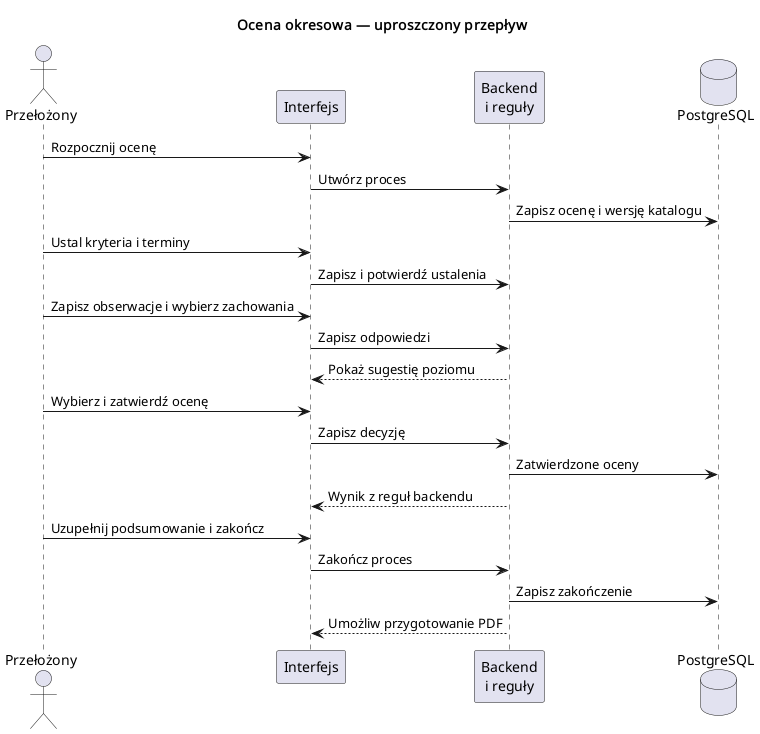

# Proces oceny i model kompetencji

## Główna ścieżka

1. Przełożony rozpoczyna ocenę przypisanego pracownika.
2. W ocenie okresowej ustala kryteria oraz terminy. Może użyć analizy OSP jako
   pomocy w wyborze dodatkowych kryteriów.
3. Przełożony zapisuje obserwacje i przygotowuje rozmowę.
4. Dla wskaźników wybiera opisy zachowań, które zaobserwował.
5. Backend oblicza sugestię poziomu kompetencji. Przełożony osobno zatwierdza
   ocenę cząstkową. Może wybrać poziom inny niż sugerowany.
6. Backend oblicza wynik na podstawie zatwierdzonych ocen. Po uzupełnieniu
   wymaganych danych przełożony kończy proces.
7. Użytkownik może przygotować dokument PDF zakończonej oceny.

To uproszczenie oceny okresowej. Pierwsza ocena ma osobny workflow, w tym
sprawozdanie i dane egzaminu. Aplikacja obsługuje formularze okresowe B i C oraz
ścieżkę pierwszej oceny. Nie zakładaj, że przejścia i pola są identyczne.

## Co chroni spójność

- Ocena wskazuje wersję katalogu kompetencji. Późniejsza zmiana katalogu nie
  powinna zmieniać znaczenia wcześniejszych wyborów.
- Każdy zapis używa rewizji oceny. Konflikt wersji zwraca błąd `409` zamiast
  nadpisać nowszą zmianę.
- Zmiana odpowiedzi wskaźnika lub notatki wymaga ponownej decyzji dla danego
  kryterium. Sugestia nie jest zatwierdzoną oceną.
- Backend sprawdza uprawnienia, status i warunki przejścia. Zakończona ocena
  jest chroniona przed edycją.
- PDF odzwierciedla zapisany proces. Wygenerowanie dokumentu nie jest podpisem
  elektronicznym ani potwierdzeniem doręczenia.

Kod: [`assessments/`](../../backend/app/modules/assessments/),
[`catalog/`](../../backend/app/modules/catalog/),
[`documents/`](../../backend/app/modules/documents/).
