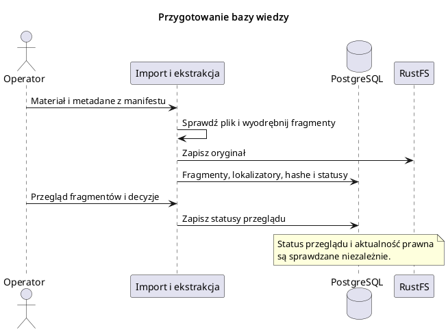
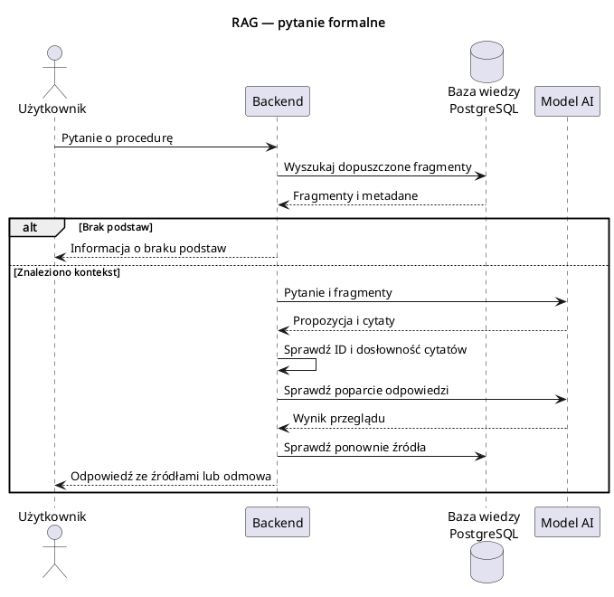
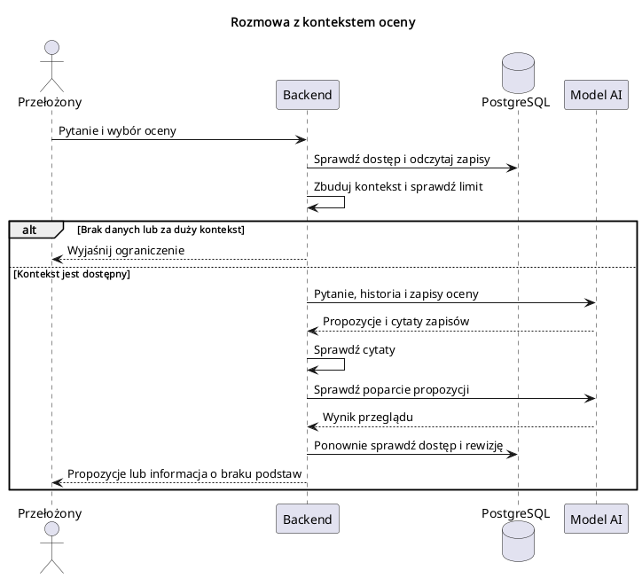

# Asystent i RAG

## Dwie funkcje w jednym panelu

| Tryb | Dane wejściowe | Rezultat |
| --- | --- | --- |
| Przepisy i procedury | Pytanie i dopuszczone fragmenty bazy wiedzy. | Wyjaśnienie z cytatami albo informacja o braku podstaw. |
| Rozmowa z pracownikiem | Pytanie oraz, po wyborze oceny, jej zapisane obserwacje, zachowania i decyzje. | Propozycje rozmowy z odniesieniami do zapisów oceny. |

W trybie rozmowy bez wybranej oceny asystent korzysta z ogólnej ścieżki wiedzy.
Zawartość OSP nie jest automatycznie dołączana do rozmowy o pracowniku. Analiza
OSP jest [osobną funkcją](osp.md). Właściwy wynik oceny oblicza backend, nie LLM.

## RAG dla pytań formalnych

RAG (*retrieval-augmented generation*) łączy wyszukiwanie materiałów z
generowaniem odpowiedzi. Model otrzymuje wybrane fragmenty, zamiast polegać
wyłącznie na swojej pamięci.

### Przygotowanie wiedzy

Materiały są importowane z manifestu źródeł. Ekstraktor dzieli je na fragmenty
z lokalizatorami i sumami kontrolnymi. Oryginały trafiają do prywatnego storage,
a metadane i fragmenty do PostgreSQL. Przegląd przypisuje decyzje do fragmentów;
status wierności i status aktualności prawnej są odrębne. Wyszukiwarka stosuje
filtry przed użyciem fragmentów w odpowiedzi. Import dokumentu nie oznacza, że
każdy jego fragment może zostać użyty jako podstawa odpowiedzi.

### Odpowiedź na pytanie

1. Backend wyszukuje tekst w PostgreSQL. Używa wyszukiwania pełnotekstowego,
   a nie embeddingów ani osobnej bazy wektorowej.
2. Filtry sprawdzają m.in. typ źródła, status, aktualność, pochodzenie i hash.
   Do kontekstu trafiają tylko dopuszczone fragmenty.
3. Model przygotowuje odpowiedź i dosłowne cytaty z przekazanych fragmentów.
4. Backend sprawdza identyfikatory, treść cytatów i metadane. Drugi prompt
   sprawdza, czy materiał uzasadnia odpowiedź. Backend ponownie sprawdza źródła.
5. Jeśli podstawy lub kontrole są niewystarczające, asystent zgłasza ograniczenie.

Oryginał i lokalizacja pomagają użytkownikowi sprawdzić odpowiedź. Adresy do
źródeł pochodzą z metadanych, nie są generowane przez model. Drugi prompt nie jest
niezależną ekspertyzą prawną. Żadna z tych kontroli nie gwarantuje poprawności.

## Rozmowa oparta na ocenie

Backend najpierw sprawdza dostęp do wybranej oceny. Zapisane informacje przesyła
do skonfigurowanego zewnętrznego dostawcy AI. Mogą one zawierać dane osobowe,
nawet jeśli osobna migawka tożsamości nie jest częścią kontekstu. Historia
obejmuje maksymalnie cztery poprzednie wymiany; nie jest źródłem faktów.

Odpowiedź zawiera odniesienia do zapisów oceny. Backend sprawdza dosłowność
cytatów, a drugi prompt ocenia ich związek z odpowiedzią. Po generowaniu backend
ponownie sprawdza dostęp i rewizję. Limit kontekstu jest jawny; system nie obcina
go po cichu. Historia panelu pozostaje w pamięci interfejsu, nie jest trwałym
archiwum rozmowy.

Ta funkcja jest w trakcie prac. Jej ostatnie zmiany nie przeszły jeszcze testów
ani weryfikacji z działającym modelem.

## Stan bazy wiedzy

Ostatni opisany import obejmuje cztery źródła i 64 fragmenty. Siedemnaście
fragmentów zatwierdzono pod względem wierności, a 47 oczekuje przeglądu. Sama
zgodność ekstrakcji nie potwierdza aktualności ani stosowalności prawa.
Ustawa, FAQ, formularze i poradniki nie były wówczas zatwierdzoną wiedzą do
odpowiedzi. Wynik ograniczonej ewaluacji: 28 poprawnych rezultatów na 30,
w tym dwie nadmiarowe odmowy. Szczegóły: [ewaluacja](../assistant-evaluation.md)
i [rejestr postępu](../backend-progress.md).

Kod: [`ai/service.py`](../../backend/app/modules/ai/service.py),
[`ai/conversation.py`](../../backend/app/modules/ai/conversation.py),
[`knowledge/retriever.py`](../../backend/app/modules/knowledge/retriever.py).
