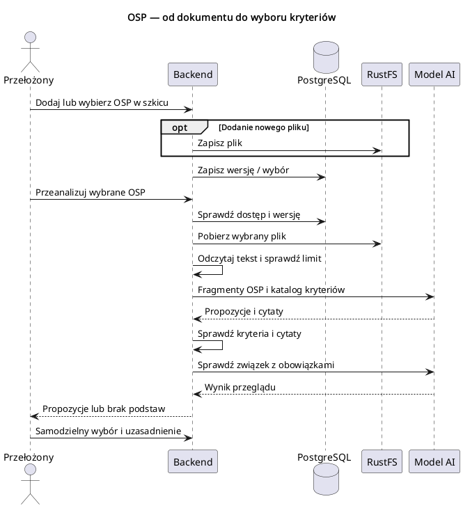

# Analiza opisu stanowiska pracy

OSP opisuje zadania i wymagania stanowiska. Nie jest dowodem tego, jak pracownik
wykonał pracę. Analiza wspiera dobór dodatkowych kryteriów oceny okresowej.
Nie ustala poziomu kompetencji ani oceny osoby.

1. Przełożony dodaje lub wybiera OSP pracownika w szkicu oceny. Dokument może
   być plikiem PDF lub DOCX o rozmiarze do 10 MiB.
2. Po uruchomieniu analizy backend sprawdza dostęp, wybraną wersję i rewizję.
   Pobiera plik z prywatnego magazynu i wyodrębnia jego tekst.
3. Backend przekazuje fragmenty OSP i katalog kryteriów do zewnętrznego modelu.
   Dokument może zawierać dane osobowe lub inne informacje poufne.
4. Model proponuje maksymalnie trzy dodatkowe kryteria oraz cytaty. Backend
   sprawdza identyfikatory, dozwolone kryteria i dosłowność cytatów. Drugi prompt
   sprawdza związek propozycji z obowiązkami.
5. Przełożony sprawdza propozycje, sam wybiera kryteria i zapisuje uzasadnienie.
   Analiza nie wybiera ani nie zapisuje kryteriów automatycznie.

Backend ponownie sprawdza dostęp i wersję podczas analizy. Plik bez czytelnego
tekstu, np. skan bez OCR, nie daje podstaw do rekomendacji. Przy przekroczeniu
limitu kontekstu analiza odmawia zamiast cicho obciąć dokument. Działanie zależy
od dostępności dostawcy AI. Kontrole nie gwarantują trafności rekomendacji.

OSP ma wersje przypisane do pracownika. Ocena zachowuje wybraną wersję. Dodanie
nowego dokumentu nie podmienia wersji w poprzedniej ocenie. Przykładowe dane
demonstracyjne są fikcyjne; generowane OSP mają uproszczoną strukturę i nie są
wiernymi kopiami dostarczonych wzorów.

Kod: [`ai/osp.py`](../../backend/app/modules/ai/osp.py),
[`documents/`](../../backend/app/modules/documents/),
[`osp-analysis-panel.tsx`](../../frontend/src/features/assessments/osp-analysis-panel.tsx).
