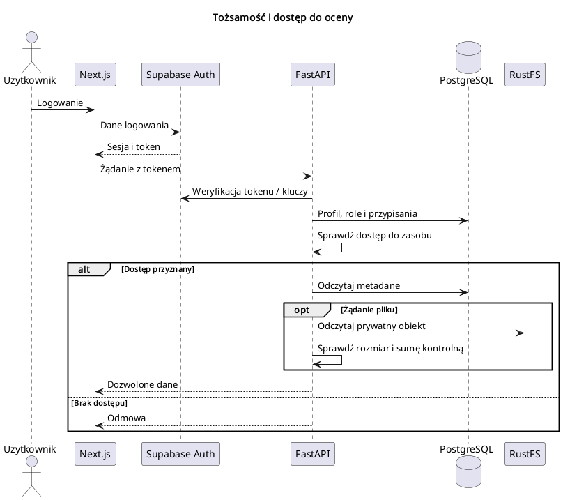

# Dane i bezpieczeństwo

## Uwierzytelnianie i uprawnienia

Supabase Auth potwierdza tożsamość. Backend weryfikuje token i pobiera lokalny
profil, role oraz przypisania z PostgreSQL. Sam token ani sama znajomość UUID
nie nadają prawa do konkretnej oceny. Backend sprawdza dostęp do zasobu.

| Rola | Przykładowy zakres |
| --- | --- |
| MANAGER | Prowadzi oceny w zakresie aktualnych uprawnień i przypisań. |
| HR | Monitoruje dozwolone metadane procesów i terminów. Nie otrzymuje treści ocen. |
| ADMIN | Administruje lokalnymi użytkownikami i rolami. Sama rola nie daje dostępu do treści ocen. |

HR może zapisać przypomnienie dla właściwego przełożonego. Jest ono dostępne w
aplikacji; nie oznacza wysłania e-maila ani potwierdzenia odczytu.

## Przechowywanie

PostgreSQL przechowuje dane aplikacji i metadane dokumentów. RustFS przechowuje
pliki w prywatnym buckecie. Backend po sprawdzeniu dostępu obsługuje pobranie;
sprawdza również rozmiar i sumę kontrolną pliku. OSP i inne prywatne dokumenty
nie są włączane do wspólnego indeksu wiedzy prawnej.

## Przekazanie do AI

- Pytanie formalne: pytanie i wybrane fragmenty bazy wiedzy.
- Rozmowa z kontekstem: pytanie, ograniczona historia i zapisane dane oceny.
- Analiza OSP: tekst wybranego OSP oraz kontekst katalogu.

Dwie ostatnie ścieżki mogą przekazywać dane osobowe lub poufne do zewnętrznego
dostawcy. Autoryzacja i sprawdzenie cytatów nie zastępują oceny warunków usługi,
retencji, lokalizacji danych i zabezpieczeń przed użyciem rzeczywistych danych.
Tekst dokumentów i notatek jest traktowany przez prompty jako dane, nie polecenia;
nie jest to gwarancja odporności na manipulację modelem.

Kod: [`core/security.py`](../../backend/app/core/security.py),
[`users/`](../../backend/app/modules/users/),
[`integrations/storage.py`](../../backend/app/integrations/storage.py).
