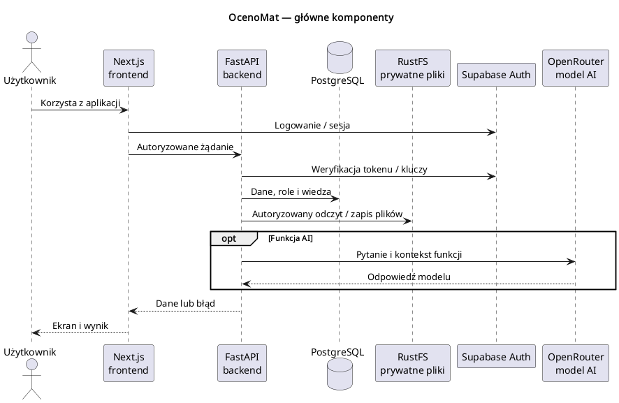
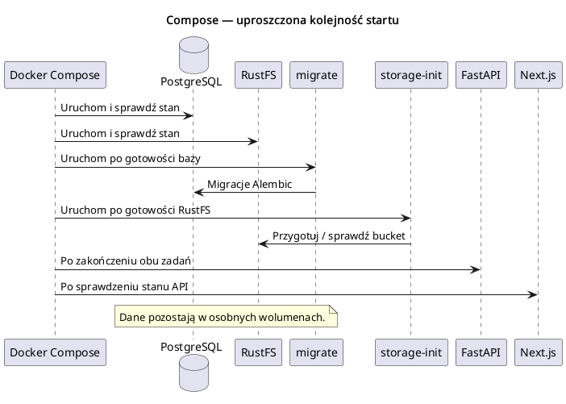

# System i kontenery

## Cel

OcenoMat prowadzi przełożonego przez ocenę pracownika. Backend przechowuje
decyzje i oblicza wynik. Asystent wspiera użytkownika, ale nie podejmuje decyzji
za przełożonego.

## Komponenty

| Komponent | Odpowiedzialność |
| --- | --- |
| Next.js | Wyświetla strony, obsługuje sesję i wywołuje API. |
| FastAPI | Sprawdza dostęp, prowadzi workflow, oblicza wyniki i obsługuje AI. |
| PostgreSQL | Przechowuje dane biznesowe, role, historię oraz fragmenty wiedzy. |
| RustFS | Przechowuje prywatne pliki przez interfejs zgodny z S3. |
| Supabase Auth | Uwierzytelnia użytkownika. Uprawnienia biznesowe ustala API. |
| OpenRouter | Udostępnia model językowy przez wymienialny adapter backendu. |

Backend jest modularnym monolitem. Moduły dotyczą m.in. ocen, pracowników,
dokumentów, monitoringu i wiedzy. To jedna aplikacja, a nie zestaw niezależnie
wdrażanych mikroserwisów. Nie ma osobnej kolejki ani bazy wektorowej.

## Środowisko lokalne

Docker Compose uruchamia bazę, RustFS, backend i frontend. Zadanie `migrate`
stosuje migracje Alembic. Zadanie `storage-init` przygotowuje lub sprawdza
prywatny bucket. Backend czeka na zakończenie obu zadań. Frontend czeka na
sprawdzenie stanu backendu.

PostgreSQL i RustFS korzystają z osobnych wolumenów. Wariant developerski
udostępnia porty na `127.0.0.1` i montuje kod do odczytu. Supabase oraz
OpenRouter działają poza Compose. Konfiguracja lokalna nie jest gotowym
wdrożeniem produkcyjnym. Szczegóły: [`infra/README.md`](../../infra/README.md).

## Kontrakty i konfiguracja

FastAPI udostępnia schemat OpenAPI. Frontend korzysta z typów wygenerowanych ze
schematu. Adresy usług i dane dostępowe pochodzą z konfiguracji środowiska.
Sekretów nie należy umieszczać w kodzie ani dokumentacji.

Kod: [`infra/compose.yaml`](../../infra/compose.yaml),
[`backend/app/main.py`](../../backend/app/main.py),
[`frontend/src/lib/api/`](../../frontend/src/lib/api/).
