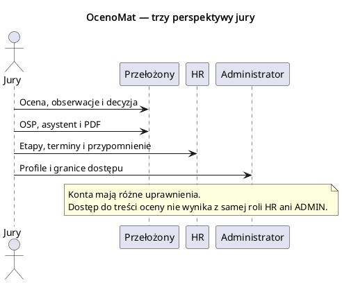

# OcenoMat — przewodnik testowania dla jury

Ten przewodnik pokazuje, jak sprawdzić prototyp z perspektywy przełożonego,
pracownika HR i administratora. Każdy scenariusz opisuje działania w aplikacji
oraz to, na co warto zwrócić uwagę podczas oceny.

[Zobacz galerię zrzutów](galeria/README.md) z rzeczywistej sesji demo.

## 1. Przed rozpoczęciem

Otwórz adres aplikacji przekazany przez zespół i zaloguj się na wskazane konto
demonstracyjne. Lokalny adres to `http://localhost:3000/login`; ten adres działa
tylko na komputerze, na którym uruchomiono aplikację. Dane dostępu przekazuje
operator demonstracji. Publiczny adres dostępny dla jury musi zostać osobno
udostępniony i sprawdzony przez zespół.

| Konto demonstracyjne | Rola | Główny cel testu |
| --- | --- | --- |
| `konto-przelozony@hacknation.pl` | Przełożony | Przejście przez ocenę i sprawdzenie asystenta. |
| `konto-hr@hacknation.pl` | HR | Monitorowanie etapów i przypomnienia. |
| `konto-admin@hacknation.pl` | Administrator | Przegląd profili i sprawdzenie granic dostępu. |

Wyloguj się przed zmianą konta. Przyciski **Wyloguj się** i **Widok HR** znajdują
się w dolnej części bocznego menu. Dostępność kont, danych i AI zależy od
konfiguracji środowiska. Liczby oraz statusy mogą się zmieniać w trakcie testów.

Pracuj na fikcyjnych danych. Tworzenie oceny, zapisywanie zmian, potwierdzanie
etapów, wysyłanie przypomnień oraz generowanie dokumentu zmieniają stan wspólnego
środowiska. Przed zakończeniem oceny upewnij się, że wybrano scenariusz
przeznaczony do testu: zakończonego procesu nie można dalej edytować.

## 2. Co potrafi każda rola?

| Działanie | Przełożony | HR | Administrator |
| --- | --- | --- | --- |
| Przeglądać profile | Przypisanych osób | Profile organizacji | Profile organizacji |
| Prowadzić i zatwierdzać oceny | Własne, przy aktualnym przypisaniu | Nie z samej roli HR | Nie z samej roli ADMIN |
| Widzieć notatki i oceny cząstkowe | W dostępnej własnej ocenie | Nie z samej roli HR | Nie z samej roli ADMIN |
| Monitorować procesy organizacji i wysłać przypomnienie | Własny pulpit i terminy | Tak, w **Widoku HR** | Nie z samej roli ADMIN |
| Zmieniać konta, role i przypisania w panelu | Nie | Nie | Panel nie jest jeszcze dostępny |

Jedno konto może mieć kilka ról. Tabela opisuje dostęp wynikający z każdej roli
oddzielnie. Zmiany kont i przypisań wykonuje obecnie operator wdrożenia.

## 3. Przełożony — pełna ścieżka oceny okresowej

**Cel:** sprawdź przebieg procesu, model kompetencji, sugestię systemu i decyzję
człowieka. Zaloguj się jako przełożony.

### 3.1. Rozpocznij ocenę

1. Otwórz **Pracownicy** i wybierz przypisaną osobę przeznaczoną do testów.
   Ocena Tomasza Jaworskiego została już utworzona i zakończona podczas sesji
   przedstawionej w galerii. Po inną osobę do nowego procesu zwróć się do operatora.
2. Otwórz **Oceny → Nowa ocena**. Wybierz **Ocena okresowa B/C** oraz pracownika.
3. Sprawdź stanowisko. Aplikacja dobiera B albo C na podstawie profilu. Kliknij
   **Dalej**; nowa ocena jest osobnym procesem.

**Sprawdź:** czy aplikacja pokazuje pracownika, rodzaj oceny i właściwy formularz
oraz czy prowadzi przez kolejne kroki. Arkusz A nie jest obecnie obsługiwany.

### 3.2. Sprawdź OSP i ustal kryteria

1. W części ustaleń otwórz **Analiza OSP**. Dodaj lub wybierz zapisany opis
   stanowiska. Własny plik PDF albo DOCX dodasz jako **Nowa wersja OSP pracownika**;
   limit pliku to 10 MiB. Użyj tylko danych fikcyjnych.
2. Kliknij **Przeanalizuj wybrane OSP**. Jeśli usługa AI jest dostępna i dokument
   zawiera czytelny tekst, sprawdź propozycje, uzasadnienia oraz cytaty. Otwórz
   oryginał, aby porównać wskazane fragmenty.
3. Przejdź do **Kryteria**. Zobacz kryteria obowiązkowe. Opcjonalnie wybierz do
   trzech dodatkowych i uzasadnij wybór obowiązkami ze stanowiska.
4. Kliknij **Zapisz kryteria i przejdź do terminów**. Uzupełnij daty i wymagane
   potwierdzenia, a następnie wybierz **Zapisz terminy i czynności** oraz
   **Potwierdź ustalenia**.

**Sprawdź:** AI proponuje kryteria na podstawie OSP, ale ich nie wybiera ani
nie zapisuje za przełożonego. Brak wystarczających podstaw lub niedostępność
usługi może uniemożliwić rekomendację. Po potwierdzeniu ustaleń wybór OSP,
kryteria i terminy na tym etapie są zamknięte do edycji.

### 3.3. Zapisz obserwacje i przygotuj rozmowę

1. Otwórz **Obserwacje** i wybierz **Rozpocznij okres obserwacji**.
2. Dodaj fikcyjny przykład zachowania, przypisz go do kryterium i daty. Zapisz go.
   Przykład: „Przygotował zestawienie danych i wyjaśnił zespołowi źródła liczb”.
3. Otwórz **Rozmowa oceniająca**. Zapisz agendę, mocne strony lub obszary rozwoju.
4. Po zakończeniu pracy nad tym etapem w scenariuszu zapisz datę rozmowy i wybierz
   **Potwierdź odbytą rozmowę**. Potwierdzenie zamyka edycję obserwacji i rozmowy.

**Sprawdź:** można wrócić do zapisanej pracy. Potwierdzenie jest zapisem
czynności w prototypie, a nie podpisem lub potwierdzeniem przez pracownika.

### 3.4. Oceń zachowania i zakończ proces

1. Otwórz **Ocena zachowań**. Dla kolejnych wskaźników wybierz opisy, które
   odpowiadają obserwacjom. Gdy brak podstaw, użyj dostępnej opcji braku obserwacji.
2. Wybierz **Zapisz odpowiedzi**. Porównaj sugestię systemu z własną oceną.
3. Wybierz i zatwierdź ocenę dla każdego kryterium. Możesz podjąć decyzję inną
   niż sugestia. Zmiana odpowiedzi lub notatki wymaga ponownego zatwierdzenia
   tego kryterium.
4. W **Wynik i zakończenie** sprawdź wynik i jego kompletność. Uzupełnij
   podsumowanie i wymagane pola. Wynik negatywny wymaga uzasadnienia.
5. Zapisz podsumowanie i zakończ proces. Następnie w **Dokumenty i PDF**
   uzupełnij dane wymagane przez formularz i wygeneruj PDF.

**Sprawdź:** sugestia nie zastępuje decyzji przełożonego. Wynik formalny oblicza
backend na podstawie zapisanych decyzji. PDF nie jest podpisany ani doręczony.
Po zakończeniu ocena jest tylko do odczytu.

### Szybkie sprawdzenie bez tworzenia całego procesu

W **Ocenach** wyszukaj **Michała Sokołowskiego**. W przygotowanych danych jego
zakończony arkusz B pokazuje decyzję przełożonego inną od sugestii systemu.
**Katarzyna Wysocka** ma bieżącą i wcześniejszą ocenę; **Robert Kubiak** —
zakończony wynik negatywny. Widoczność i stan zależą od aktualnego środowiska.

## 4. Przełożony — pierwsza ocena

**Cel:** zobacz odrębną ścieżkę, a nie wariant formularza oceny okresowej.

1. W **Ocenach** wyszukaj **Natalię Zawadzką** i otwórz jej pierwszą ocenę.
   Przygotowany scenariusz zaczyna się na etapie ustaleń wstępnych.
2. Sprawdź dane kwalifikacji i część dotyczącą rozmowy wstępnej oraz terminów.
3. W kolejnych etapach aplikacja prowadzi przez sprawozdanie, egzamin, rozmowę
   oceniającą i ocenę pięciu elementów. Wymagane dane i potwierdzenia zależą od
   etapu. Używaj **Zapisz etap** przed przejściem dalej.
4. Aby obejrzeć wynik negatywny, sprawdź przygotowaną ocenę **Igora Błaszczyka**.

Możesz też rozpocząć nową pierwszą ocenę przez **Oceny → Nowa ocena → Pierwsza
ocena**. Utworzenie wymaga danych kwalifikacji, w tym dat i podstawy zatrudnienia.
Wpisuj wyłącznie dane zgodne z fikcyjnym scenariuszem i komunikatami formularza.
Kryteria i skala pierwszej oceny różnią się od ścieżki okresowej.

## 5. Przełożony — przetestuj asystenta AI

Otwórz przycisk **Zapytaj OcenoMat** w nagłówku. Funkcje AI wymagają dostępnej
i skonfigurowanej usługi zewnętrznej. Wynik może różnić się między próbami.

### Pytania o przepisy i procedury

1. Wybierz tryb **Przepisy i procedury**. Otwarta ocena nadaje pytaniu kontekst
   jej rodzaju: pytanie o ocenę okresową zadaj przy ocenie okresowej.
2. Zapytaj: „Ile kryteriów dodatkowych można wybrać w ocenie okresowej?”
3. Sprawdź, czy odpowiedź wskazuje podstawę. Rozwiń cytat i otwórz źródło,
   jeżeli jest dostępne.
4. Zapytaj o pierwszą ocenę, np. „Jaka jest skala punktowa pierwszej oceny?”.
   Otwórz wcześniej pierwszą ocenę i sprawdź źródło.
5. Sprawdź brak podstaw pytaniem: „Co nakazuje § 999 rozporządzenia o ocenach
   okresowych?”. Asystent nie powinien wymyślać treści fikcyjnego przepisu.

**Sprawdź:** czy odpowiedź pasuje do rodzaju oceny, czy cytat ją uzasadnia oraz
czy brak podstaw jest jasno zgłoszony. Nie każda odmowa oznacza brak odpowiedzi
w prawie: dostępna baza wiedzy jest obecnie ograniczona.

### Przygotowanie rozmowy o pracowniku

1. Wybierz **Rozmowa z pracownikiem** i otwórz ocenę z zapisanymi danymi, np.
   ocenę **Łukasza Brzezińskiego**, albo użyj przycisku wyboru pracownika i oceny.
2. Zapytaj: „Jakie pytania warto zadać na podstawie zapisanych obserwacji?”.
3. Rozwiń podstawy odpowiedzi i porównaj je z zapisami oceny. Zwróć uwagę na
   różnicę między obserwacją, sugestią a decyzją przełożonego.
4. Zadaj pytanie uzupełniające. Możesz skopiować odpowiedź lub wybrać
   **Nowa rozmowa**.

Ta ścieżka korzysta z zapisanych danych, a nie z niezapisanych zmian formularza.
Gdy brak informacji lub poparcia, może nie zwrócić propozycji. Treść OSP nie
jest automatycznie dołączana do tej rozmowy; jej analiza jest osobną funkcją.
Kontekst oceny i analiza OSP trafiają do zewnętrznej usługi AI. Ostatnie zmiany
rozmowy kontekstowej nadal wymagają pełnej weryfikacji.

## 6. HR — monitoring i przypomnienie

**Cel:** sprawdź zarządzanie procesem bez dostępu do poufnej treści oceny.

1. Wyloguj się i zaloguj jako HR. Otwórz **Widok HR** w dolnej części menu.
2. Sprawdź liczbę wszystkich procesów, niezakończonych oraz wymagających uwagi.
3. W rejestrze wybierz **Wymagają uwagi**. Otwórz **Szczegóły** przy wybranym
   procesie, np. dotyczącym **Ewy Rutkowskiej**, jeśli jest dostępny.
4. Sprawdź etap, terminy i historię przypomnień. Wybierz **Wyślij przypomnienie
   w aplikacji**, jeżeli przycisk jest dostępny i test może zmienić dane.
5. Wyloguj się, zaloguj jako przełożony i sprawdź **Przypomnienia od HR** na
   pulpicie. Dostarczenie oznacza zapis w aplikacji, nie wysłanie e-maila ani
   potwierdzenie odczytu.

**Sprawdź:** HR widzi metadane potrzebne do monitorowania. Sama rola HR nie
ujawnia notatek, ocen cząstkowych ani dokumentów prywatnej oceny. Przypomnienie
może być niedostępne m.in. dla zakończonego procesu lub bez aktywnego przypisania.

## 7. Administrator — dostęp i jego granice

1. Wyloguj się i zaloguj jako administrator.
2. Otwórz **Pracownicy**. Wyszukaj osobę i sprawdź podstawowy profil.
3. Otwórz **Oceny** oraz **Pomoc** i przeczytaj informację o uprawnieniach roli.
4. Sprawdź, że sama rola ADMIN nie udostępnia prywatnych treści ocen ani panelu HR.

**Ważne:** nie ma jeszcze panelu do tworzenia kont ani zmiany ról i przypisań.
Nie należy przedstawiać tych czynności jako dostępnych w interfejsie. Osobne
role mogą zostać nadane temu samemu kontu przez operatora środowiska.

## 8. Jak scenariusze odpowiadają kryteriom jury?

| Kryterium z wyzwania | Co sprawdzić w prototypie |
| --- | --- |
| Zgodność merytoryczna i założenia — **25%** | Dwie ścieżki oceny; kryteria i formularze; wybór zachowań; sugestia i decyzja przełożonego. Porównaj odpowiedzi i PDF z właściwymi materiałami. |
| Użyteczność i doświadczenie — **25%** | Kolejność etapów, czytelność formularzy, zapis i powrót do pracy, wyszukiwanie oraz komunikaty o brakujących danych. |
| Jakość i użyteczność AI — **20%** | Pytania formalne ze źródłami, odmowa przy braku podstaw, rekomendacje OSP i pomoc w rozmowie o zapisanej ocenie. Sprawdź cytaty i trafność. |
| Innowacyjność i jakość rozwiązania — **20%** | Połączenie OSP, modelu kompetencji, zapisanych obserwacji i asystenta; wersje danych oraz oddzielenie sugestii od decyzji. |
| Potencjał wdrożeniowy — **10%** | Role i granice dostępu, prywatne pliki, API, kontenery oraz jawnie opisane ograniczenia i dalszy rozwój. |

To mapa funkcji do sprawdzenia, nie deklaracja uzyskania punktów ani pełnej
zgodności prawnej. [Architektura](architecture/README.md) opisuje rozwiązanie,
a [rejestr postępu](backend-progress.md) podaje wyniki weryfikacji i blokery.

## 9. Gdy coś nie działa

- **Brak osoby lub oceny:** sprawdź konto i przypisanie. Poproś operatora o
  wskazanie dostępnego scenariusza. HR i administrator nie mają automatycznie
  dostępu do treści oceny.
- **Nie można przejść dalej:** sprawdź komunikaty, wymagane pola oraz to, czy
  poprzedni etap został zapisany i potwierdzony.
- **AI odmawia lub zgłasza błąd:** sprawdź zakres pytania, podstawy, czytelność
  OSP i dostępność usługi. Brak podstaw nie jest równoznaczny z błędem interfejsu.
- **Brak scenariuszy demo:** dane mogły nie zostać zaimportowane w tym środowisku
  albo mogły się zmienić podczas testów. Operator ma instrukcję w
  [przewodniku demonstracji](demo-guide.md).
